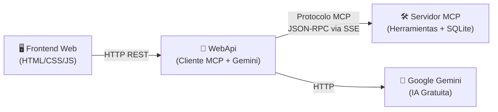
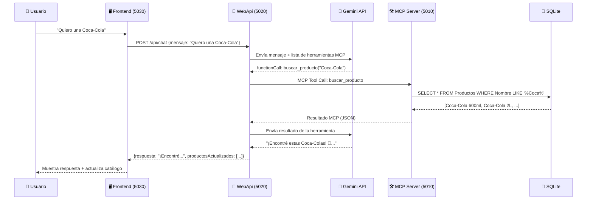

# 🏪 La Tiendita del Barrio — Arquitectura MCP Completa

## ¿Qué vamos a hacer?

Vamos a convertir tu tiendita en una **arquitectura profesional de 3 capas** usando el estándar **MCP (Model Context Protocol)**. Esto es lo que usan las empresas de IA más grandes del mundo para conectar modelos de lenguaje con herramientas externas.



### ¿Qué es MCP y por qué importa?

> [!NOTE]
> **MCP (Model Context Protocol)** es como un "USB universal" para IA. Antes, si querías que tu IA usara una base de datos, tenías que programar la integración a mano para cada modelo. Con MCP, creas un servidor estándar UNA VEZ y cualquier IA compatible (Claude, Gemini, GPT, etc.) puede usarlo automáticamente.

### La Arquitectura: 3 Proyectos

| Proyecto | Rol | Analogía |
|----------|-----|----------|
| **TiendaMCP.Server** | Servidor MCP con las herramientas | 🔧 El mecánico (ejecuta las acciones) |
| **TiendaMCP.WebApi** | API Web + Cliente MCP + Gemini | 🧠 El gerente (piensa y delega) |
| **TiendaAsistenteVoz** | Frontend visual | 🖥️ La tienda (lo que ve el cliente) |

## User Review Required

> [!IMPORTANT]
> ### Sobre la Base de Datos
> **SQLite es suficiente para tu demo.** No necesitas instalar nada extra. SQLite es una base de datos "embebida" — vive dentro de un archivo (`.db`) en tu proyecto. Para demos, prototipos y apps con pocos usuarios simultáneos, es perfecta. Solo necesitarías PostgreSQL o SQL Server si tuvieras cientos de usuarios concurrentes.

> [!IMPORTANT]
> ### Sobre la IA (Gemini)
> Usaremos tu **API key gratuita de Google Gemini** que ya tienes configurada (`TU_API_KEY`). El modelo `gemini-flash-lite-latest` es gratuito y suficiente para la demo. **No necesitas Ollama** a menos que quieras funcionar 100% offline.

## Open Questions

> [!WARNING]
> **¿Quieres que la API key de Gemini se lea de un archivo de configuración** (`appsettings.json`) en vez de estar hardcodeada? Es una buena práctica de seguridad que te enseño a hacer. **Recomiendo que sí.**

---

## Proposed Changes

### 1. Estructura de Carpetas Final

```
📁 TiendaMCP/
├── 📁 TiendaMCP.Server/          ← NUEVO: Servidor MCP
│   ├── Program.cs                 ← Configuración del servidor MCP
│   ├── Tools/
│   │   └── TiendaTools.cs         ← Las 4 herramientas MCP
│   ├── Data/
│   │   └── DatabaseInitializer.cs ← Inicialización de BD + datos semilla
│   ├── TiendaMCP.Server.csproj
│   └── tiendita.db                ← Base de datos SQLite
│
├── 📁 TiendaMCP.WebApi/           ← NUEVO: API intermediaria
│   ├── Program.cs                 ← API REST + Cliente MCP + Gemini
│   ├── TiendaMCP.WebApi.csproj
│   └── appsettings.json           ← API key de Gemini aquí
│
├── 📁 TiendaAsistenteVoz/         ← EXISTENTE: Frontend (se modifica poco)
│   ├── Program.cs                 ← Se simplifica (solo sirve archivos)
│   ├── wwwroot/
│   │   ├── index.html
│   │   ├── app.js                 ← Se actualiza URL del API
│   │   └── styles.css
│   └── TiendaAsistenteVoz.csproj
│
└── TiendaMCP.sln                  ← NUEVO: Solución que agrupa todo
```

---

### Componente 1: TiendaMCP.Server (Servidor MCP)

Este es el corazón de MCP. Expone las herramientas de la tienda como funciones estándar que cualquier IA puede llamar.

#### [NEW] TiendaMCP.Server.csproj
- Target: `net10.0`
- Paquetes NuGet:
  - `ModelContextProtocol.AspNetCore` — SDK oficial de MCP para ASP.NET Core
  - `Dapper` — ORM ligero para SQL
  - `Microsoft.Data.Sqlite` — Driver de SQLite

#### [NEW] Program.cs
- Registrar servicios MCP con `AddMcpServer().WithHttpTransport().WithToolsFromAssembly()`
- Mapear endpoints MCP con `app.MapMcp()` (crea automáticamente los endpoints SSE + JSON-RPC)
- Inicializar la base de datos al arrancar
- **Puerto: 5010**

#### [NEW] Tools/TiendaTools.cs
- Clase decorada con `[McpServerToolType]`
- 4 métodos con `[McpServerTool]` + `[Description()]`:
  1. `buscar_producto(string nombre)` — Busca en SQLite por nombre/marca/categoría
  2. `agregar_carrito(int id_producto, int cantidad)` — Agrega al carrito con validación de stock
  3. `ver_carrito()` — Muestra items del carrito con subtotales
  4. `eliminar_carrito(int id_item)` — Elimina un item y restaura stock

#### [NEW] Data/DatabaseInitializer.cs
- Migrado del `Program.cs` actual
- Crea tablas `Productos` y `Carrito`
- Inserta los 50 productos mexicanos con imágenes

---

### Componente 2: TiendaMCP.WebApi (API Web + Cliente MCP)

Este proyecto es el "cerebro" que conecta el frontend con Gemini y el servidor MCP.

#### [NEW] TiendaMCP.WebApi.csproj
- Target: `net10.0`
- Paquetes NuGet:
  - `ModelContextProtocol` — SDK oficial (modo cliente)
  - Sin Dapper/SQLite (no accede a la BD directamente, usa MCP)

#### [NEW] Program.cs
- **`POST /api/chat`** — Recibe mensaje del usuario → construye prompt para Gemini con las herramientas MCP → ejecuta el Tool Calling loop → devuelve respuesta
- **`GET /api/productos`** — Llama a la herramienta MCP `buscar_producto` directamente
- **`POST /api/carrito`**, **`GET /api/carrito`**, **`DELETE /api/carrito/{id}`** — Llaman a herramientas MCP correspondientes
- Conecta como **cliente MCP** al servidor (TiendaMCP.Server) vía HTTP/SSE
- Lee las herramientas disponibles del servidor MCP automáticamente
- Construye el payload de Gemini con las herramientas descubiertas dinámicamente
- **Puerto: 5020**

#### [NEW] appsettings.json
- `Gemini:ApiKey` — Tu API key (buena práctica: no hardcodeada)
- `Gemini:Model` — `gemini-flash-lite-latest`
- `McpServer:Url` — `http://localhost:5010`

---

### Componente 3: TiendaAsistenteVoz (Frontend — Modificación mínima)

#### [MODIFY] [Program.cs](file:///d:/lalog/Documents/proyectosprogramacionpersonales/TiendaMCP/TiendaAsistenteVoz/Program.cs)
- Se simplifica drásticamente: solo sirve archivos estáticos (HTML/CSS/JS)
- Se elimina toda la lógica de Gemini, SQLite, y endpoints de API
- Solo queda `UseStaticFiles()` y `MapFallback()` a `index.html`
- **Puerto: 5030**

#### [MODIFY] [app.js](file:///d:/lalog/Documents/proyectosprogramacionpersonales/TiendaMCP/TiendaAsistenteVoz/wwwroot/app.js)
- Cambiar `API_BASE` de `''` a `'http://localhost:5020'` (apuntar al WebApi)
- El resto del frontend se mantiene igual (chat, voz, carrito, catálogo)

#### [MODIFY] [TiendaAsistenteVoz.csproj](file:///d:/lalog/Documents/proyectosprogramacionpersonales/TiendaMCP/TiendaAsistenteVoz/TiendaAsistenteVoz.csproj)
- Se eliminan paquetes Dapper y Microsoft.Data.Sqlite (ya no los necesita)

---

### Componente 4: Solución Global

#### [NEW] TiendaMCP.sln
- Agrupa los 3 proyectos para abrirlos juntos en Visual Studio / VS Code

---

## Flujo Completo (¿Cómo funciona todo junto?)



## Verification Plan

### Paso 1: Compilar todo
```bash
dotnet build TiendaMCP.sln
```

### Paso 2: Levantar los 3 servidores (en 3 terminales)
```bash
# Terminal 1 — Servidor MCP
cd TiendaMCP.Server && dotnet run

# Terminal 2 — WebApi
cd TiendaMCP.WebApi && dotnet run

# Terminal 3 — Frontend
cd TiendaAsistenteVoz && dotnet run
```

### Paso 3: Probar
1. Abrir `http://localhost:5030` en el navegador
2. Verificar que el catálogo carga (productos vienen desde MCP Server → WebApi → Frontend)
3. Abrir el chat y escribir "¿Qué leches tienes?"
4. Verificar que Gemini llama la herramienta MCP y responde con productos reales
5. Agregar productos al carrito desde el chat y desde los botones
6. Verificar que el carrito se actualiza correctamente

### Manual Verification
- El chat responde en español mexicano
- Los productos muestran imágenes reales
- El carrito suma correctamente
- La voz funciona (Text-to-Speech y Speech-to-Text)
