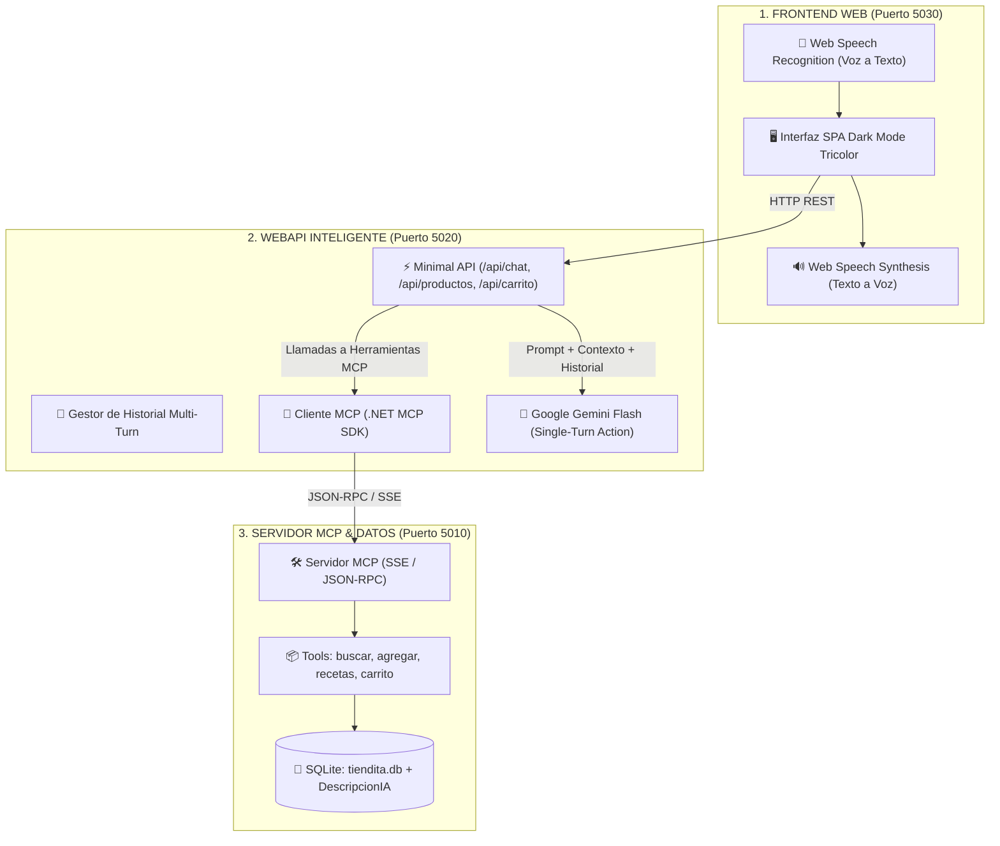
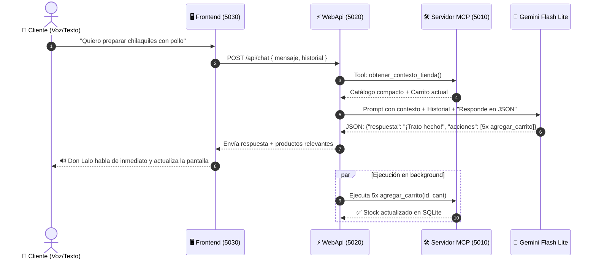

# 🏪 La Tiendita del Barrio — Documentación Técnica y Ejecutiva
### Arquitectura de Comercio Conversacional con MCP (Model Context Protocol) y Gemini AI

---

> [!NOTE]
> **Ficha Técnica del Proyecto:**
> - **Plataforma:** .NET 10 (C# moderno, Minimal APIs)
> - **Protocolo Central:** Model Context Protocol (MCP) estándar vía `ModelContextProtocol.AspNetCore` v2.2.0 (JSON-RPC sobre Server-Sent Events - SSE)
> - **Motor de Inteligencia Artificial:** Google Gemini (`gemini-flash-lite-latest`)
> - **Base de Datos:** SQLite embebido con Dapper ORM
> - **Frontend:** Single Page Application (HTML5, Vanilla CSS3 Moderno, JavaScript ES2024, Web Speech API)
> - **Diseño Visual:** Dark Mode Tricolor Mexicano (Verde Esmeralda `#00C476`, Blanco Puro `#FFFFFF`, Rojo Carmesí `#EF4444`)

---

## 1. Resumen Ejecutivo (Executive Summary)

### ¿Qué es este proyecto?
**La Tiendita del Barrio** es una plataforma de **comercio conversacional y asistente de voz inteligente** para compras de abarrotes y mandado casero. Permite a los usuarios interactuar de forma natural mediante voz o texto con **"Don Lalo"**, un tendero virtual dotado de personalidad cálida mexicana y conocimiento culinario, capaz de recomendar recetas, buscar productos en tiempo real, filtrar inventario y gestionar el carrito de compras automáticamente.

### ¿Qué problema de negocio resuelve?
1. **Fricción en el e-commerce tradicional:** Buscar producto por producto en un catálogo extenso cansa al usuario. Con este sistema, el usuario solo dice: *“Se me antojan unos chilaquiles con pollo para desayunar”* y la IA arma el combo de 5 ingredientes y los agrega al carrito en 1 segundo.
2. **Accesibilidad total mediante Voz:** Personas que no saben o no quieren teclear en pantallas pequeñas pueden hacer su mandado completo hablando de manera cotidiana.
3. **Desacoplamiento e Interoperabilidad:** Mediante el protocolo **MCP**, la tienda no depende de un modelo de IA específico; cualquier agente inteligente (Claude, ChatGPT, Gemini, Copilot o Cursor) puede conectarse y operar la tienda sin modificar una sola línea del backend.

---

## 2. ¿Qué es MCP (Model Context Protocol) y por qué es revolucionario?

**MCP** es un estándar abierto creado originalmente por Anthropic y rápidamente adoptado por gigantes como Microsoft y Google. En el mundo del software se le conoce como **el "USB universal" de la Inteligencia Artificial**.

```
  ┌──────────────────────────────────────────────────────────┐
  │                 CLIENTES DE IA (CONSUMIDORES)            │
  │  Claude Desktop  /  Gemini API  /  Cursor  /  Tu WebApi  │
  └────────────────────────────┬─────────────────────────────┘
                               │  Protocolo MCP Estándar
                               │  (JSON-RPC 2.0 vía SSE)
  ┌────────────────────────────▼─────────────────────────────┐
  │             SERVIDOR MCP (La Tiendita del Barrio)        │
  │  - Expone herramientas con [McpServerTool]               │
  │  - Define contratos con [Description] legibles por la IA │
  │  - Conecta con SQLite, ERPs, APIs y reglas de negocio    │
  └──────────────────────────────────────────────────────────┘
```

### Ventajas Estratégicas para la Empresa:
* **Zero Vendor Lock-in:** Si mañana la empresa decide migrar de Gemini a Claude o a un modelo local (Llama/Mistral), **el Servidor MCP no cambia en lo absoluto**.
* **Seguridad y Control de Acceso:** La IA no ejecuta código arbitrario ni accede a la base de datos directamente; solo invoca las herramientas reguladas que el servidor expone.
* **Descubrimiento Dinámico:** Los modelos de IA interrogan al servidor mediante `tools/list` y descubren en tiempo real qué funciones existen y cómo usarlas.

---

## 3. Arquitectura del Sistema (3 Capas Independientes)

El sistema está diseñado en una arquitectura orientada a servicios desacoplados con 3 proyectos independientes:



### Detalle de los 3 Componentes:

| Componente | Carpeta | Puerto | Responsabilidad |
| :--- | :--- | :--- | :--- |
| **TiendaMCP.Server** | `TiendaMCP.Server` | `5010` | **Servidor MCP Puro:** Expone el catálogo y la lógica de negocio mediante herramientas MCP formales sobre HTTP/SSE. Gestiona SQLite con Dapper. |
| **TiendaMCP.WebApi** | `TiendaMCP.WebApi` | `5020` | **El "Cerebro" Orquestador:** Actúa como cliente MCP, precarga el contexto de la tienda, mantiene la memoria conversacional multi-turn y dialoga con Gemini para generar respuestas habladas y acciones concurrentes. |
| **TiendaAsistenteVoz** | `TiendaAsistenteVoz` | `5030` | **Frontend & Experiencia de Usuario:** Interfaz web moderna en modo oscuro, síntesis y reconocimiento de voz nativos, catálogo filtrable en vivo y carrito sincronizado. |

---

## 4. Catálogo de Herramientas MCP Expuestas

En `TiendaTools.cs`, el servidor implementa y expone 6 herramientas con el decorador `[McpServerTool]`:

| Herramienta | Parámetros | Descripción para la IA |
| :--- | :--- | :--- |
| `buscar_producto` | `string nombre` | Busca artículos en el inventario por nombre, marca, categoría o sinónimos (`DescripcionIA`). |
| `agregar_carrito` | `int id_producto, int cantidad` | Valida stock disponible, realiza *UPSERT* en la tabla `Carrito` y descuenta el stock en `Productos`. |
| `consultar_receta` | `string platillo` | **🆕 Capacidad culinaria:** Resuelve ingredientes de platillos típicos (chilaquiles, guacamole, sincronizadas, hot dogs, etc.), consulta precios y devuelve los IDs exactos. |
| `ver_carrito` | *(sin parámetros)* | Lista los artículos actuales en el carrito, cantidades, subtotales y total a pagar. |
| `eliminar_carrito` | `int id_item` | Elimina un artículo del carrito y **restaura el stock** del producto automáticamente. |
| `confirmar_orden` | *(sin parámetros)* | Genera el folio de orden `ORD-XXXXX`, vacía el carrito y confirma el pedido contra entrega. |
| `obtener_contexto_tienda` | *(sin parámetros)* | Devuelve el catálogo y el carrito en formato compacto para alimentar el patrón Single-Turn de Gemini. |

---

## 5. Patrones de Ingeniería Clave

### A. Patrón Single-Turn Action (Alta Velocidad para Voz)

> [!TIP]
> **El problema del Multi-Turn clásico:**  
> Normalmente, un agente de IA requiere 2 a 3 llamadas de red por cada interacción:
> 1. Usuario habla → 2. Gemini pide ejecutar Tool → 3. Servidor responde → 4. Gemini genera texto final.
> **Latencia resultante:** 4 a 7 segundos 🐌 *(inaceptable para interfaces de voz en tiempo real)*.

**Nuestra Solución (Single-Turn Action):**
1. La WebApi invoca la herramienta MCP `obtener_contexto_tienda()` en milisegundos locales.
2. Se realiza **UNA SOLA llamada a Gemini** inyectando el catálogo vigente y el carrito.
3. Gemini devuelve un JSON estructurado con dos elementos simultáneos:
   - `respuesta`: Frase amigable y cálida que el frontend **empieza a hablar de inmediato**.
   - `acciones`: Array con las mutaciones de carrito que se ejecutan en segundo plano en el servidor MCP.
**Latencia lograda:** **~1.1 segundos** ⚡ *(la voz responde instantáneamente)*.



### B. Búsqueda Semántica Ligera (`DescripcionIA`)
En lugar de implementar infraestructuras complejas y costosas como bases de datos vectoriales dedicadas (ChromaDB, Pinecone o pgvector), cada producto almacena una cadena de metadatos semánticos:
```sql
-- Ejemplo: Producto 'Coca-Cola Original 600ml'
DescripcionIA: "coca-cola|refresco|gaseosa|soda|bebida|cola|azucarada|600ml|$20|250cal|NO-diabeticos|popular:95|fria|antojo"
```
Esto permite que cuando un usuario dice *"tráeme una soda helada"* o *"algo para diabéticos"*, el motor SQLite o la IA resuelvan la correspondencia exacta por sinónimos con cero consumo de GPU.

### C. Memoria Conversacional Multi-Turn
El endpoint `/api/chat` mantiene un historial contextual de los últimos 6 a 8 turnos. Esto permite diálogos encadenados naturales:
- *Usuario:* "¿Tienes queso y jamón?"
- *Don Lalo:* "¡Claro vecino! Tengo queso Oaxaca, panela y jamón de pierna Fud."
- *Usuario:* "Échamelos al carrito." *(Gemini entiende a qué se refiere "los" gracias al historial).*

---

## 6. Experiencia de Usuario (UX) y Diseño Visual

1. **Modo Oscuro Tricolor:**
   - Inspirado en la bandera mexicana con tono nocturno moderno: Verde Esmeralda (`#00C476`) para botones principales, estados activos y ondas de voz; Blanco Puro (`#FFFFFF`) para lectura de alto contraste; y Rojo Carmesí (`#EF4444`) para badges de carrito, advertencias y etiquetas de precio.
2. **Estandarización Forzosa de Imágenes:**
   - Cada tarjeta de producto tiene un contenedor de `175px` de altura fija con halo radial oscuro y `object-fit: contain`. Todas las tarjetas mantienen la misma altura y alineación en rejilla, independientemente del tamaño de la imagen original.
3. **Voz Bidireccional Integrada:**
   - Reconocimiento de voz continuo mediante el micrófono del navegador (`webkitSpeechRecognition`) y síntesis de voz natural (`SpeechSynthesis`) afinada en tono y ritmo para sonar como un tendero alegre.

---

## 7. Guion de Demostración para Presentar a tu Jefe (Demo Pitch)

Para una reunión de 5 minutos con tu jefe o equipo directivo, sigue este guion:

### Paso 1: Introducción (30 segundos)
> *"Jefe, hoy les quiero presentar un demo funcional que desarrollé para explorar **MCP (Model Context Protocol)**, el nuevo estándar de la industria impulsado por Anthropic, Microsoft y Google para conectar Inteligencia Artificial con sistemas empresariales. Lo aplicamos a un caso real de comercio electrónico: **La Tiendita del Barrio**."*

### Paso 2: Mostrar la Arquitectura (45 segundos)
> *"El sistema tiene 3 capas totalmente independientes:*
> 1. *El **Servidor MCP** que expone la base de datos y reglas de negocio como herramientas formales.*
> 2. *La **WebApi** que conecta el modelo Gemini de Google con el protocolo MCP.*
> 3. *El **Frontend Web** con reconocimiento y síntesis de voz en modo oscuro con identidad mexicana."*

### Paso 3: Demostración en Vivo (2 minutos)
1. **Abrir la web:** `http://localhost:5030`.
2. **Mostrar el catálogo:** Muestra cómo las imágenes están estandarizadas y cómo funcionan los filtros por categoría (incluyendo el filtro nuevo **"🍳 Para Cocinar"**).
3. **Probar el Chat Culinario por Voz:**
   - Presiona el botón del chat flotante.
   - Presiona el micrófono o haz clic en el botón rápido:  
     👉 **"Arma el combo para unos Chilaquiles Verdes con pollo"**
   - **Escucha la voz de Don Lalo:** Hablará cálidamente diciendo que te armó el combo y en pantalla se filtrarán los 5 ingredientes (totopos, pollo, salsa verde, crema y queso cotija).
4. **Probar la Memoria Multi-Turn:**
   - Escribe o habla:  
     👉 **"Trato hecho Don Lalo, agrégalos al carrito"**
   - Muestra cómo el carrito se abre automáticamente y los 5 productos aparecen ya registrados en la base de datos con su total calculado.
5. **Cerrar la compra:**
   - Di: **"Quiero finalizar mi compra"** → Don Lalo genera el número de orden `ORD-XXXXX` y confirma el pedido.

### Paso 4: Conclusión e Impacto Empresarial (1 minuto)
> *"Lo valioso aquí no es solo la tienda, sino la **arquitectura MCP**: este mismo servidor de herramientas podría ser consultado por un asistente de WhatsApp empresarial, por un bot en Microsoft Teams, o por agentes autónomos de servicio al cliente sin tener que reescribir la lógica de inventario."*

---

## 8. Cómo Levantar el Proyecto Localmente

Abre 3 terminales en la carpeta raíz `<ruta-local>\TiendaMCP`:

```bash
# Terminal 1 — Servidor MCP (Puerto 5010)
cd TiendaMCP.Server
dotnet run

# Terminal 2 — WebApi Inteligente (Puerto 5020)
cd TiendaMCP.WebApi
dotnet run

# Terminal 3 — Frontend Web (Puerto 5030)
cd TiendaAsistenteVoz
dotnet run
```

Abre tu navegador en:  
👉 **`http://localhost:5030`**
